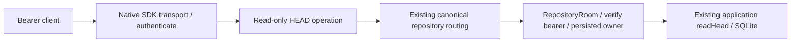

# Agent tool qualification and authority

## Decision

Use **Option A**, the installed DeepSpace native agent-tool dispatcher, with one
read-only tool: `miniagentgit.repository_head`. Mount it in the existing Hono
application through `registerAgentToolTransports`. Do not add an AI chat,
RecordRoom executor, user-wide store, custom MCP server or local adapter.

This lower-level SDK function also provides a native stateless JSON-RPC MCP
subset. That installed implementation is locally exercised, including with the
SDK's MCP test client. It is not a hosted, Codex or Claude Code qualification.
The application remains undeployed; both public integrations remain planned.

## Qualification matrix

| Question                                  | Classification                                                    | Evidence and boundary                                                                                                                                                                                                      |
| ----------------------------------------- | ----------------------------------------------------------------- | -------------------------------------------------------------------------------------------------------------------------------------------------------------------------------------------------------------------------- |
| 1. Named agent tools in 0.44.2?           | Verified locally                                                  | One request-scoped ToolSet entry is discovered and invoked by the installed dispatcher. Names, descriptions, input/output schemas and execute functions are supported.                                                     |
| 2. Installed CLI exposure?                | Verified locally (help/source only)                               | `deepspace agent tools` and `agent invoke` exist and use canonical REST paths. End-to-end CLI invocation is not qualified: its scoped credential does not satisfy the unchanged repository verifier.                       |
| 3. Actual transport?                      | Verified locally                                                  | CLI implementation uses REST; the installed Worker dispatcher supports REST discovery/invocation, Markdown discovery and POST JSON-RPC MCP.                                                                                |
| 4. Native remote MCP?                     | Verified locally; requires hosted qualification                   | initialize/list/call/notifications work through local workerd and the SDK test client. Remote operation, actual client compatibility and credential acquisition are unverified.                                            |
| 5. Registration/configuration/deployment? | Verified locally for source wiring; requires hosted qualification | Mounting the SDK routes is sufficient locally. Existing app vars identify metadata. No migration, additional binding or resource is needed. Hosted availability requires a separately authorized deployment.               |
| 6. Tool identity authentication?          | Verified locally                                                  | Existing authenticate → SDK verifyJwt validates public key, issuer, audience and expiration. Bearer user credentials only. SDK agent-scoped and app-scoped tokens remain rejected.                                         |
| 7. Verified subject?                      | Verified locally                                                  | authenticate returns the existing typed Principal. The handler retains the original bearer rather than constructing a trusted subject header; the owner verifies it again and obtains the persisted-authorization subject. |
| 8. Secure repository access?              | Verified locally                                                  | Existing routeRepository → canonical RepositoryRoom → existing owner HTTP read → application readHead → repository authority/SQLite. Alice succeeds; Bob/Charlie fail.                                                     |
| 9. Actual local transport testing?        | Verified locally                                                  | Miniflare dispatchFetch reaches the bundled application and real workerd SQLite DOs. No mocked successful SQL transaction is used.                                                                                         |
| 10. Direct Codex/Claude consumption?      | Requires hosted/client qualification                              | Neither binary/configuration/credential flow was exercised. The SDK test client is not evidence for these products. No public installation instructions are enabled.                                                       |

Unsupported **in this integration**: a stdio bridge, GET/SSE MCP stream, arbitrary
code execution, generic record mutations and the remaining version-control tools.
The native MCP GET route answers 405; POST returns JSON and has no session IDs.
No OAuth discovery/authorization-server integration or client-specific setup was
added. A custom local adapter is not justified while the native transport can be
qualified further.

The [public guide](https://docs.deep.space/guides/local-agent-tools.md) describes
CLI tools as REST and labels native MCP a staging prototype. That wording is not
our evidence of availability: the exact installed 0.44.2 declarations, exported
runtime and local tests establish the narrower facts above. No newer SDK was
installed or staging service called. `registerAgent` is a **scaffold-local**
helper, not an SDK export.

## Installed APIs and source locations

Paths below are relative to the repository's installed dependencies:

- `node_modules/deepspace/dist/worker.d.ts:2895–2907` declares
  `registerAgentToolTransports<AppEnv extends {Bindings: object}>(app, options)`.
  Options provide `basePath`, `resolveTools(Request, Env): Promise<ToolSet |
Response>`, `describe(Env): {id, name}`, optional `requestBodyCap` and `resultCap`.
- `worker.d.ts:2810–2864` declares the higher-level route environment/options and
  `AgentToolContext {env, userId, request}`. Its factory accepts
  `buildTools(executor, context)`, `resolveAccess` and optional browser access.
- `worker.d.ts:2866–2891` declares SDK `AgentToolError(code, message, status?)` and
  `createUserToolExecutor(env, userId, signal, {room?})`.
- `worker.js:11423` implements the low-level dispatcher; `:11569` implements
  `registerAgentToolRoutes`, which supplies canonical agent/browser prefixes.
- `worker.js:11295` implements the generic RecordRoom executor, eagerly choosing
  a RecordRoom and using its internal trusted-user-header protocol. That is not
  the repository authority protocol and is deliberately unused here.
- `worker.js:11355` performs schema validation, execution, output validation,
  size enforcement and SDK error conversion; `:10427–10448` defines protocol
  versions and Origin checking. Supported versions are 2025-11-25, 2025-06-18
  and 2025-03-26. Header absence is allowed; a foreign Origin is denied.
- `worker.js:10901–10920` implements `agentTokenIssuer` and
  `verifyAgentToken(config, token, targetOrigin)` with a separate issuer,
  origin audience and `agent` scope.
- `node_modules/deepspace/dist/cli.js:1309` mints an agent token;
  `:13021–13089` invokes discovery/calls over REST. CLI help confirms app/URL,
  tool name, JSON input/file/stdin, timeout and JSON-output options.
- `node_modules/deepspace/dist/testing-mcp.d.ts` and `testing-mcp.js:25` provide
  `createMcpTestClient(baseUrl, {endpoint?, fetch?})`, initialize/list/call/notify,
  `McpRpcError` and `McpTransportError`. Only tests import this entry point.

Worker SDK artifact SHA-256:
`9505d94f5c3f2778174085ae645324184b30e6cbd9758e7de6f6d5e6876c37b3`.
The module's bundled original-source comments identify
`src/server/agent-tools.ts` and `src/shared/mcp-protocol.ts`.

## Contracts and schemas

Input: exactly `{repositoryId: string}` satisfying the existing repository-ID
validator. Owner, user, namespace and routing overrides are rejected. Result:
`{repositoryId, commitId: string | null, version: number}`. Commit IDs use the
existing validator; the version must be a nonnegative safe integer, with null
HEAD exactly when the version is zero. Result objects contain only these fields.

`src/features/agent-tools/contracts.ts` owns readonly contracts and boundary
validation. `repository-head.ts` composes the validated request with an explicit
reader dependency. The server adapter supplies that reader bound to the verified
bearer; no database or commit logic is duplicated.

`schemas.ts` implements the public [Standard Schema and Standard JSON Schema
v1 interfaces](https://standardschema.dev/), which the installed AI schema
consumer recognizes. No direct import of a hoisted AI/Zod package, private schema
symbol or new dependency is used. These are small fixed schemas, not a schema
framework. Domain validation returns discriminated results; the SDK-facing schema
boundary throws fixed sanitized errors. This avoids its AI TypeValidationError
including the rejected value in validation details. Invalid input containing a
real test JWT is tested to produce no token reflection.

## Authentication and read path

The lower-level registrar delegates authentication to resolveTools; it does not
create authority. We use the same existing authenticate function as HTTP. No app
membership table or generic SDK users/records permission model is introduced.
Discovery requires a verified identity but returns only one static tool schema
and public app metadata. Repository authorization occurs on every invocation.

Only an internal **GET** to `/api/repositories/:id/head` is possible. The URL is
reconstructed from the validated ID, and only Authorization is forwarded. No
caller-provided x-user-id, cookie, owner, namespace or tool-selected path is used.
RepositoryRoom preserves canonical identity and re-verifies the bearer; the
existing service checks stored ownership and reads the authoritative HEAD.
No code here advances HEAD, enqueues commits, activates CI or mutates job state.

### Credential incompatibility that remains closed

The installed CLI exchanges its login for an origin-bound **agent-scoped** token.
The SDK supplies verifyAgentToken for that credential. MiniAgentGit's existing
repository verifier accepts the established user Bearer contract and rejects
scoped credentials. The local test proves that a correctly signed agent token
passes SDK verifyAgentToken yet fails this tool/owner policy with 401.

Consequently, `deepspace agent tools/invoke` is not claimed operational for this
app. No credential was relabelled, no user ID was substituted and no machine
scope was added to the ordinary API. Hosted credential acquisition and a secure
agent admission/delegation design must be qualified before real CLI/client use.
This is an interoperability blocker, not permission to weaken verifyJwt.

## Wire contract and bounds

The SDK mounts, under `/_deepspace/agent`:

| Method/path                                | Contract                                                                                 |
| ------------------------------------------ | ---------------------------------------------------------------------------------------- |
| GET `/tools`                               | Authenticated metadata `{ok:true, app, tools}`                                           |
| GET `/tools.md`                            | Authenticated SDK-generated schema text, including its native transport references       |
| POST `/tools/miniagentgit.repository_head` | `{input:{repositoryId}}` → `{ok:true,result:{repositoryId,commitId,version}}`            |
| POST `/mcp`                                | Installed JSON-RPC initialize, ping, tools/list and tools/call; notifications return 202 |
| Other methods on `/mcp`                    | 405, Allow: POST                                                                         |

These are local qualification routes, not public Codex/Claude setup claims.
The public site and installation selectors are unchanged. SDK Markdown discovery
is authenticated; it describes the actually tested SDK surface, not hosted/client
availability. There is no `/.well-known/mcp` or root `/mcp` implementation added.

Tool URLs are capped at 2,048 characters and reject queries; bodies at 2,048 bytes;
owner HEAD responses and tool results at 1,024 bytes. The SDK additionally bounds
metadata and serializes responses. Result cap is not a total MCP-envelope cap:
JSON-RPC echoes a request ID and may carry both text and structuredContent.
All such input is covered by the request cap; this is not a global ingress,
concurrency, CPU or credit bound.

Auth errors retain the existing typed HTTP envelopes/statuses. REST invocation
uses SDK envelopes: input 400, missing/invalid identity 401, owner denial 403,
missing repository/tool 404, body too large 413 and owner/runtime unavailability 503. Raw owner error bodies are discarded; only fixed messages and expected
codes escape. SDK MCP call errors are HTTP 200 with `result.isError: true`, not
successful tool execution; pre-dispatch authentication can instead return HTTP
401/503. Clients must inspect protocol outcomes, not only HTTP status.

## TOOL invariants and resource limits

TOOL-001/002: verified identity only, never input identity. TOOL-003: persisted
owner check and canonical room. TOOL-004: static authenticated discovery has no
repository contents. TOOL-005: strict serializable shapes and byte caps.
TOOL-006: validated arguments and no routing overrides. TOOL-007: failures remain
errors (including MCP isError). TOOL-008: GET-only owner read; no HEAD or CI
mutation. TOOL-009: allowlisted fields, fixed errors and no token propagation to
outputs. TOOL-010: no Codex/Claude compatibility/configuration claim.

No new service, deployment, paid resource, broker or polling loop is needed.
Valid missing IDs may still instantiate a room and its existing schema, as with
the current repository HTTP reads; the tool does not solve app-wide allocation
or rate limits. Read-only domain behavior is not a promise of zero platform cost
or zero cold-start/schema work. Account-wide limits and hosted behavior remain
unqualified. The application stays undeployed.

## Recommended PASS 08B

First qualify the official agent credential path and an explicit, narrowly scoped
repository-authority admission policy without substituting headers or minting
session tokens. Preserve issuer/audience/scope checks and persisted ownership.
Then expand bounded operation tools through existing application seams, with
failure/isolation/atomicity evidence for each operation. Exercise actual Codex and
Claude Code protocol/configuration/auth flows before changing public statuses.
The native SDK transport should be evaluated before any custom MCP adapter;
none is currently demonstrated necessary. Deployment remains a separate approval.
