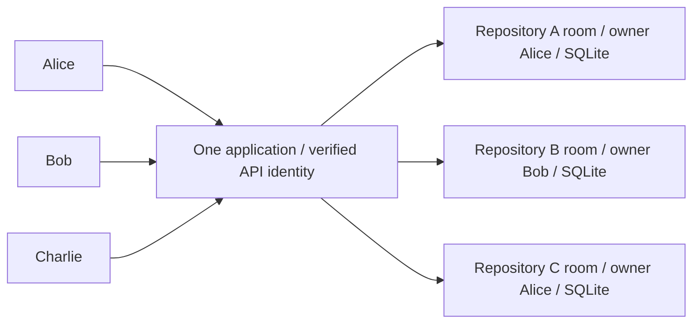

# Authentication and tenant isolation

## Authority and identity

One application serves multiple users. Each validated repository ID routes through
its existing canonical RepositoryRoom namespace. The room persists its owner
subject, immutable commits, HEAD, scheduler and CI records in repository-owned
SQLite. A user may own multiple repositories; there is no user-wide authority or
ownership registry. Knowledge of a repository or job ID grants no permission.

DeepSpace authenticates identity. MiniAgentGit independently authorizes each
repository operation against the persisted owner. Browser session information is
an interface hint, never server authorization. There are no collaborators,
organizations, invitations or global repository enumeration.

## Implemented contracts

- **AUTH-001:** protected API identity comes exclusively from SDK `verifyJwt` with
  trusted public key, issuer and audience, signature and expiration checks.
- **AUTH-002:** the repository authority checks persisted ownership for repository,
  commit, replay, tree, file and CI operations.
- **AUTH-003:** validated repository identity uses the existing canonical routing;
  requests cannot choose a namespace or override owner routing.
- **AUTH-004:** cross-owner reads, writes, CI admission, listing, receipts and
  cancellation are denied. Foreign resources cannot be retrieved via an owned room.
- **AUTH-005:** missing/invalid credentials fail closed; missing trusted verifier
  configuration returns unavailable rather than disabling verification.
- **AUTH-006:** browser integration introduces no writable repository state or HEAD.
- **AUTH-007:** credentials are absent from URLs, rendered state, diagnostics and
  persistent browser storage. Errors shown by the UI are fixed, generic messages.
- **AUTH-008:** account/session changes unmount the previous session boundary,
  abort protected requests and discard late results. Sign-out clears protected
  state before the SDK action and reloads the public page on success.
- **AUTH-009:** repositories remain private and owner-only.
- **AUTH-010:** commit transactions, expected-HEAD handling, durable idempotency,
  per-repository scheduling and CI fencing remain unchanged.

## Browser integration

Only `/dashboard` mounts authentication. `/` and `/docs` remain public, statically
bundled and provider-free. The route is a shell with no repository requests,
repository lists, commit viewers or CI panels. Loading, signed-out, expired,
checking, signed-in, error, token-unavailable and configuration-unavailable states
use shared presentation primitives. Only a verified `/api/me` response matching
the session subject permits the signed-in display.

Installed `deepspace@0.44.2` APIs actually used are `DeepSpaceAuthProvider`,
`useAuth`, `useSession`, `signIn.social({ provider, callbackURL })`, `signOut`,
`getAuthToken` and `clearAuthToken`. Providers are the SDK-supported GitHub and
Google values. Callback URLs are same-origin `/dashboard`. No custom OAuth flow,
JWT decoder, token issuer or authentication dependency was added.

The SDK browser session uses managed cookies. Its supported `getAuthToken()`
performs a same-origin POST to `/api/auth/token`; the returned Bearer JWT is a
separate API credential. CLI developer login is not such a credential. The client
never substitutes a subject or copies the SDK session cookie token into API
headers. Server SDK verification remains mandatory.

A route-owned client coalesces one outstanding SDK token acquisition, with at
most four removable waiters. SDK acquisition has no AbortSignal; late completion
is fenced and its SDK cache is cleared. A different account cannot join an old
account's acquisition. Protected reads permit at most four unsettled executions,
use a maximum ten-second deadline, and retain slots until actual settlement even
if fetch ignores cancellation. Every read first verifies `/api/me`. Results are
rechecked against session generation and expiration. There is no protected data
cache or global mutable frontend store. Tokens are capped at 8 KiB and retained
only during acquisition/request execution. GET requests use same-origin approved
API paths, no-store, omitted cookies, rejected redirects and no referrer.

## Hosted qualification boundary

The application remains unregistered. The SDK app-ID guard is intact and the
shell returns unavailable before mounting its provider without a valid registered
identity. Real public key/issuer/audience compatibility has not been qualified.
The current Hono application also does not wire the official scaffold's managed
`/api/auth/*` proxy/cookie/callback bridge; those paths currently return 404.
A valid app ID alone will not complete hosted login. Official scaffold behavior
was inspected, but its origins, cookies and token exchange must be configured and
qualified in a separately authorized hosted pass. No origin, audience, app ID or
working production login was fabricated here.

Local tests exercise the actual SDK provider/hooks and credential retrieval with
controlled session endpoints and locally signed test JWTs. The JWT-to-Hono path
uses real SDK verification. These fixtures do not prove DeepSpace-issued hosted
tokens, provider OAuth redirects, production cookies or revocation behavior.

## Evidence and remaining security limits

Workerd tests send Alice, Bob and Charlie signed requests through the actual
Hono API and canonical rooms with SQLite, including restart/recreation. Separate
SQLite scheduling tests demonstrate Bob progressing while Alice's executor is
held before its transaction. Browser fixtures verify account switching and
sign-out without credential rendering. See the PASS 06D results for exact gates.

Sign-out clears client state; it does not establish immediate server revocation
of an already-issued JWT. No new denylist is implemented. Account-wide rate,
repository cardinality and provider resource isolation remain incomplete. Valid
repository IDs can route to rooms before authorization discovers missing state;
canonical routing is not a global allocation quota. Users share one application's
billing and storage allowances. No per-user free allocation is claimed.

References: [official authentication guide](https://docs.deep.space/guides/authentication.md),
installed SDK declarations/implementation and the official
`create-deepspace@0.44.2` base scaffold HTTP adapter.
