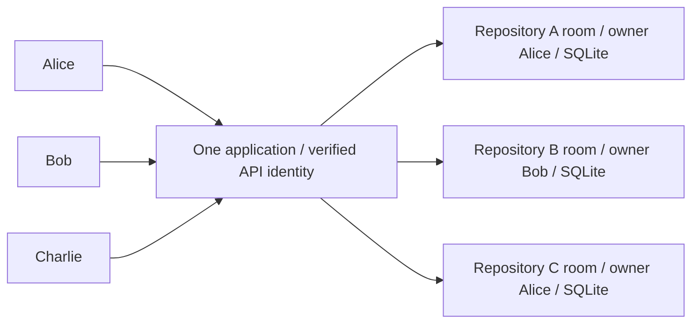

# Authentication and tenant isolation

## Authority and identity

One application serves multiple users. Each validated repository ID routes through
its existing canonical RepositoryRoom namespace. The room persists its owner
subject, immutable commits, HEAD, scheduler and CI records in repository-owned
SQLite. A user may own multiple repositories; there is no user-wide authority or
ownership registry. Knowledge of a repository or job ID grants no permission.

DeepSpace authenticates identity. MiniAgentGit independently authorizes each
repository operation against the persisted owner. Browser session information is
an interface hint, never server authorization. There are no collaborators,
organizations, invitations or global repository enumeration.

## Implemented contracts

- **AUTH-001:** protected API identity comes exclusively from SDK `verifyJwt` with
  trusted public key, issuer and audience, signature and expiration checks.
- **AUTH-002:** the repository authority checks persisted ownership for repository,
  commit, replay, tree, file and CI operations.
- **AUTH-003:** validated repository identity uses the existing canonical routing;
  requests cannot choose a namespace or override owner routing.
- **AUTH-004:** cross-owner reads, writes, CI admission, listing, receipts and
  cancellation are denied. Foreign resources cannot be retrieved via an owned room.
- **AUTH-005:** missing/invalid credentials fail closed; missing trusted verifier
  configuration returns unavailable rather than disabling verification.
- **AUTH-006:** browser integration introduces no writable repository state or HEAD.
- **AUTH-007:** credentials are absent from URLs, rendered state, diagnostics and
  persistent browser storage. Errors shown by the UI are fixed, generic messages.
- **AUTH-008:** account/session changes unmount the previous session boundary,
  abort protected requests and discard late results. Sign-out clears protected
  state before the SDK action and reloads the public page on success.
- **AUTH-009:** repositories remain private and owner-only.
- **AUTH-010:** commit transactions, expected-HEAD handling, durable idempotency,
  per-repository scheduling and CI fencing remain unchanged.

## Browser integration

Only `/dashboard` mounts authentication. `/` and `/docs` remain public, statically
bundled and provider-free. The route is a shell with no repository requests,
repository lists, commit viewers or CI panels. Loading, signed-out, expired,
checking, signed-in, error, token-unavailable and configuration-unavailable states
use shared presentation primitives. Only a verified `/api/me` response matching
the session subject permits the signed-in display.

Installed `deepspace@0.44.2` APIs actually used are `DeepSpaceAuthProvider`,
`useAuth`, `useSession`, `signOut`,
`getAuthToken` and `clearAuthToken`. Providers are the SDK-supported GitHub and
Google values. Sign-in now uses the same `/api/auth/social-redirect` navigation as
the installed SDK AuthOverlay; the official code-exchange callback returns to
same-origin `/dashboard`. No custom OAuth flow,
JWT decoder, token issuer or authentication dependency was added.

The SDK browser session uses managed cookies. Its supported `getAuthToken()`
performs a same-origin POST to `/api/auth/token`; the returned Bearer JWT is a
separate API credential. CLI developer login is not such a credential. The client
never substitutes a subject or copies the SDK session cookie token into API
headers. Server SDK verification remains mandatory.

A route-owned client coalesces one outstanding SDK token acquisition, with at
most four removable waiters. SDK acquisition has no AbortSignal; late completion
is fenced and its SDK cache is cleared. A different account cannot join an old
account's acquisition. Protected reads permit at most four unsettled executions,
use a maximum ten-second deadline, and retain slots until actual settlement even
if fetch ignores cancellation. Every read first verifies `/api/me`. Results are
rechecked against session generation and expiration. There is no protected data
cache or global mutable frontend store. Tokens are capped at 8 KiB and retained
only during acquisition/request execution. GET requests use same-origin approved
API paths, no-store, omitted cookies, rejected redirects and no referrer.

## Hosted qualification boundary

PASS 06F registered and deployed one application. `managed-auth.ts` implements the
browser subset of the official 0.44.2 scaffold: provider redirect, one-time-code
exchange, secure HttpOnly app cookie, sign-out expiration and session/token proxy.
The proxy limits endpoint/method combinations, POST origin and token request
bytes; it never proxies generic platform integrations or enables native auth.
Configuration absence still fails closed. The official build guard remains in
place and now accepts the assigned app ID.

The deployed platform supplies its public signing key, issuer and auth-service
URL. Audience `https://api-worker.deep.space` was obtained from a platform-signed
JWT checked against the published JWKS, then confirmed by the hosted token
endpoint and `/api/me`. It was not inferred from an app ID or decoded without
verification. The public audience is stored as a Wrangler var; no signing key,
credential or session was committed. Existing-session hosted repository/CI smoke
tests pass. A fresh interactive provider OAuth round trip and browser sign-out
remain unverified unless separately confirmed in PASS 06F evidence. See
[PASS 06F results](passes/pass06f-results.md).

Local tests exercise the actual SDK provider/hooks and credential retrieval with
controlled session endpoints and locally signed test JWTs. The JWT-to-Hono path
uses real SDK verification. These fixtures do not prove DeepSpace-issued hosted
tokens, provider OAuth redirects, production cookies or revocation behavior.

## Evidence and remaining security limits

Workerd tests send Alice, Bob and Charlie signed requests through the actual
Hono API and canonical rooms with SQLite, including restart/recreation. Separate
SQLite scheduling tests demonstrate Bob progressing while Alice's executor is
held before its transaction. Browser fixtures verify account switching and
sign-out without credential rendering. See the PASS 06D results for exact gates.

Sign-out clears client state; it does not establish immediate server revocation
of an already-issued JWT. No new denylist is implemented. Account-wide rate,
repository cardinality and provider resource isolation remain incomplete. Valid
repository IDs can route to rooms before authorization discovers missing state;
canonical routing is not a global allocation quota. Users share one application's
billing and storage allowances. No per-user free allocation is claimed.

References: [official authentication guide](https://docs.deep.space/guides/authentication.md),
installed SDK declarations/implementation and the official
`create-deepspace@0.44.2` base scaffold HTTP adapter.

## PASS 08B: distinct tool credential policy

The unchanged user API policy still uses `authenticate`/SDK verifyJwt and its
configured user issuer/audience. Agent-scoped and app-scoped tokens remain
rejected by ordinary API and ordinary owner paths, including HEAD and CI.

Only /\_deepspace/agent/\* uses `authenticateTool`: established user Bearer JWTs
remain accepted; SDK verifyAgentToken separately admits signed agent JWTs with
base-issuer/agent, exact request-origin audience, exact agent scope and strictly
unexpired finite exp. Blank/anonymous subjects and unrecognized credentials fail
closed. It uses only trusted server public-key/issuer configuration; ordinary
user-audience configuration must also remain present. SDK verification errors and
decoded debug claims never escape. No user auth framework or token issuer changes.

The credential's signed sub becomes the SDK VerifiedAuth.userId. Repository
permission requires that exact subject to match the persisted owner. Additional
owner/delegation claims do not grant access; a separate agent account has no
implicit link to a human repository owner. The existing domain Principal describes
the verified account, not a replacement user credential. No user JWT is minted.

The original bearer is forwarded via the canonical app-private DurableObject
binding to a separate HEAD-only agent path and verified again there. Existing
`readHead` performs owner authorization in the same repository authority. No
synthetic identity header, caller-selected namespace, public internal endpoint,
SQL credential storage, owner-side bypass or second repository service exists.
Actual Request.url determines origin; forwarded-host and identity headers do not.
See [agent-tool trust model](agent-tool-architecture.md#pass-08b-scoped-credential-trust-model-supersedes-the-08a-blocker)
for SDK signatures, paths, limits, issuer construction and internal mechanism.

Local workerd tests cover valid user/scoped credentials, invalid signature,
issuer/origin/scope/expiry, missing trusted configuration, forged identities,
Alice/Bob/Charlie isolation, direct owner enforcement, credential-kind confusion,
read-only persistence and MCP errors. Unexpired bearer replay can repeat a read;
revocation and one-time credential semantics are not implemented. Local CLI token
exchange/401 refresh uses a simulated signing service, not platform issuance.
No hosted credential or Codex/Claude connection is claimed, no auth URLs or app
configuration changed, and the registered application remains undeployed.
