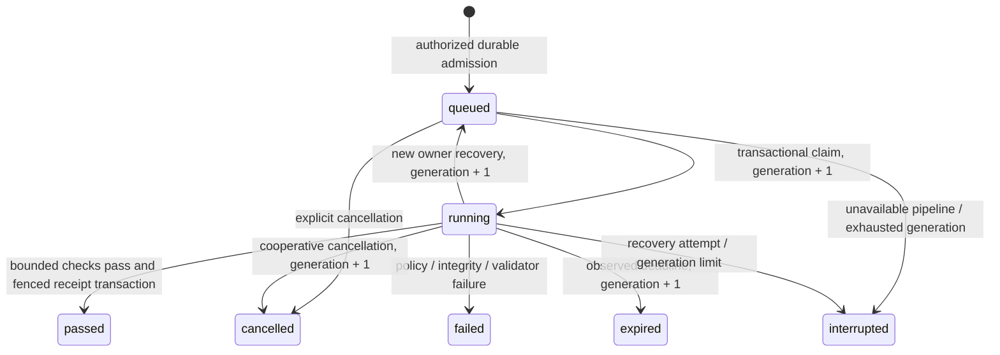

# Commit-addressed CI

PASS 05 implements local, fixed validation, not arbitrary build execution. An
owner creates an immutable commit, POSTs its exact ID to CI, gets a persisted job
with HTTP 202, then reads status/receipt. A corrected commit has a new ID; an old
failure and its original snapshot remain unchanged. CI never implicitly reads HEAD.

## Authority and identity

The existing canonical `RepositoryRoom` owns repository and CI SQLite tables.
There is one CI engine per live owner, alongside the separate commit scheduler.
Every store operation rechecks persisted ownership inside a synchronous SQL
transaction. Public and owner HTTP boundaries use the existing SDK JWT verifier.
The engine has no global registry, separate message broker or additional object.

Migration 3 adds `ci_jobs` and immutable `ci_receipts`, pending/commit indexes,
legal-transition and execution-generation triggers. Jobs reserve receipt space
at admission; no record is silently pruned. The unique identity is repository,
immutable commit, server pipeline ID, version and fingerprint. A duplicate returns
the same durable job, including terminal failures/cancellations, before checking
capacity. Unknown commits cannot be admitted. No public pipeline override exists.

`miniagentgit-ci-v1`, version 1, hashes its definition, effective limits and a
checked source fingerprint. `npm run ci:fingerprint` hashes the static relative
source dependency graph rooted in validation, pipeline definitions, receipt
construction and snapshot loading. Review and commit its JSON output after changes.
`npm run check:ci-fingerprint` and Vite configuration reject stale fingerprints.
Changed implementation/policy cannot reuse an incompatible cached result. Old
terminal receipts remain readable. Unfinished unavailable versions become
`interrupted/pipeline_unavailable`, never silently run as a different version.

## State and recovery

Terminal states have no outgoing transitions. SQL state and receipt insertion
commit together; injected receipt-write failure rolls both back. Only a current
running generation can finish. Recovery first fences old generations, then a new
claim increments generation/attempts again. At most one running job is claimed.

An authorized CI request/status/list/receipt access activates bounded recovery
once per engine instance. It discovers at most the outstanding limit of running
rows and requeues them, or writes interrupted receipts after two attempts. Queued
jobs survive unchanged. A coalesced `ctx.waitUntil(promise)` starts at most one job
per invocation. Later authorized observations advance remaining queued work; there
is no polling loop, alarm, perpetual drain or automatic cloud restart guarantee.

Cloudflare's installed `DurableObjectState.waitUntil()` extends a promise lifetime;
it is not durable job acceptance or recovery. SQLite `transactionSync()` callbacks
are synchronous. Hashing and validation await outside transactions. DeepSpace
0.44.2 documents JobRoom for longer jobs, but that separate owner is unnecessary
for this short, bounded same-repository validator. No invented SDK job API is used.

The deadline is two seconds **after claim**, enforced by a timer, authorized status
observation and final transaction time check. Queued work has no automatic wall
clock expiry. Timers cannot interrupt synchronous execution. Cancellation before
claim persists a cancelled receipt without running; active cancellation aborts
cooperatively, fences the generation and retains the active claim until the
validator actually settles. HTTP disconnect does not cancel a durable job. On
runtime death, clients have an uncertain result until the next authorized request
recovers/observes SQLite. No cancellation is described as transaction rollback.

## Fixed checks

Manifest integrity checks valid ordered unique paths, content presence, declared
UTF-8 byte counts, SHA-256 content digests, canonical manifest root and commit
metadata digest. Snapshot loading bounds metadata and file count/bytes before
copying text cells into JavaScript. Missing/corrupt snapshots fail closed.

Source policy version 1 permits lowercase extensions ts, tsx, js, jsx, json, md,
txt, css, html, yml, yaml and toml, plus `.gitignore`. Paths still meet repository
validation; `.git`, `node_modules` and `vendor` segments are forbidden. Reject NUL,
bare CR and malformed Unicode; accept CRLF. Nonempty files need a final LF; no
trailing spaces/tabs; maximum 185 physical lines (final LF adds no empty line).
Empty text is allowed. Diagnostics contain check/code/path/line, never source
snippets, tokens, exception messages or credentials. Truncation cannot erase the
failure flag. Receipts have schemaVersion 1, immutable identity, checks, bounded
diagnostics, counters and terminal state. Resource/runtime failures cannot pass.

No submitted code, package script, config, plugin, module resolution, dynamic
import, shell, lint, test or dependency install runs. Optional TypeScript syntax
checking is **deferred** and explicitly reported as such; a pass certifies only
manifest integrity and source policy, not syntactic/type correctness. The installed
TypeScript bundle trial failed neutral Worker resolution for fs/path/os/inspector.
Externalizing these yielded 9,939,861 unminified bytes, versus the pre-CI server
bundle's 1,416,981 bytes. Compatibility/budget was not demonstrated. No new parser
or production dependency was added. The build-time fingerprint script uses the
existing Node TypeScript compiler only on trusted project files.

## Bounds and invariants

All limits are positive integers, configurable downward through `ciLimits` /
engine/store construction; values above defaults are rejected. Production uses
the defaults below. No untrusted HTTP parameter changes limits.

| Bound                                  |                 Default / maximum |
| -------------------------------------- | --------------------------------: |
| queued + running jobs per repository   |                                 4 |
| all retained jobs (including terminal) |                                32 |
| reserved logical CI storage            |                           512 KiB |
| files per snapshot                     |                                32 |
| individual UTF-8 file                  |                            32 KiB |
| total UTF-8 input                      |                           128 KiB |
| diagnostics                            | 16 / 2,048 serialized UTF-8 bytes |
| receipt                                |      8,192 serialized UTF-8 bytes |
| execution attempts                     |                                 2 |
| jobs per drain                         |                                 1 |
| charged byte work per invocation       |                           512 KiB |
| execution deadline                     |              2,000 ms after claim |
| list page                              |                            8 jobs |

Work charges content read/hash, canonical metadata hash and source scans; path,
line and metadata loops are independently capped. It is a deterministic logical
work budget, not measured CPU instructions. One bounded snapshot and one promise
are active; queued jobs retain no payload. Diagnostic/output overflow fails closed.
The engine uses the durable pending index, not an extra admission ring; PASS 03
rings remain for commits/diagnostics and cannot become CI acceptance authority.

Each job reserves 1,024 + maximum receipt bytes. At default limits 32 jobs reserve
294,912 bytes; immutable terminal identities remain for deduplication. When full,
new identities get QUOTA_EXCEEDED; duplicates still replay. No deletion/cleanup API
exists. SQL page/index/trigger/WAL overhead is outside this logical accounting.
An operator policy for safely retiring a repository is deferred.

- **CI-001:** immutable commit identity, never moving HEAD.
- **CI-002:** versioned, implementation/policy fingerprinted validation.
- **CI-003:** fixed checks interpret input only as data.
- **CI-004:** bounded admission, snapshots, output and per-invocation work.
- **CI-005:** SQL acceptance precedes successful response; SQL receipt is durable.
- **CI-006:** CI writes only CI-owned rows; no commit/HEAD/ownership mutation.
- **CI-007:** immutable identity uniqueness reuses accepted/completed jobs.
- **CI-008:** exceptions, limits, unavailable pipelines and interruptions fail closed.
- **CI-009:** transactional generations fence stale execution completion.
- **CI-010:** count/byte reservations reject new work at capacity; no silent eviction.

Local Node SQLite tests prove actual rollback/fencing/store behavior. Local workerd
exercises the real worker, JWT verification and SQLite-backed Durable Object,
including runtime recreation. Its interruption test seeds a running row through
Miniflare's test-only storage inspector; it does not forcibly kill a live validator
or prove provider crash semantics. Controlled deferred validators prove early HTTP
acceptance and cancellation. Hosted OAuth, quotas, CPU/credits and automatic
restart behavior remain unverified. Production app registration/build gate remains.

References: [Cloudflare lifecycle](https://developers.cloudflare.com/durable-objects/api/state/),
[SQLite storage](https://developers.cloudflare.com/durable-objects/api/sqlite-storage-api/),
[DeepSpace rooms](https://docs.deep.space/sdk-reference/worker/rooms.md),
[DeepSpace background jobs](https://docs.deep.space/guides/background-jobs.md).

The final PASS 05 unminified server-worker test bundle measured 1,451,037 bytes
(34,056 bytes above baseline). This is a local esbuild output measurement, not
the gated production Vite bundle or a provider compressed-size measurement.

## PASS 09A alarm-driven execution

[Durable CI stages](ci-durable-stages.md) describes the current version 2
dispatch, checkpoint and deadline rules. The sections above document the PASS 05
executor and receipt compatibility. The existing HTTP routes serve both
execution paths.

## PASS 09B deterministic analysis

With the JobRoom binding, pipeline version 3 adds syntax, fixed AST lint and
snapshot-only relative imports as separately checkpointed stages. Existing
routes can return schema 1 or 2 receipts depending on the historical pipeline.
See [deterministic code analysis](ci-code-analysis.md) for the current checks
and [durable stage semantics](ci-durable-stages.md) for checkpoint validation.

## PASS 09C resource evidence

The [adversarial parser qualification](ci-parser-resource-qualification.md)
documents which ceilings apply before and after parsing. The harness and fault
tests are local tooling. They add no production validation or fingerprint
inputs.
